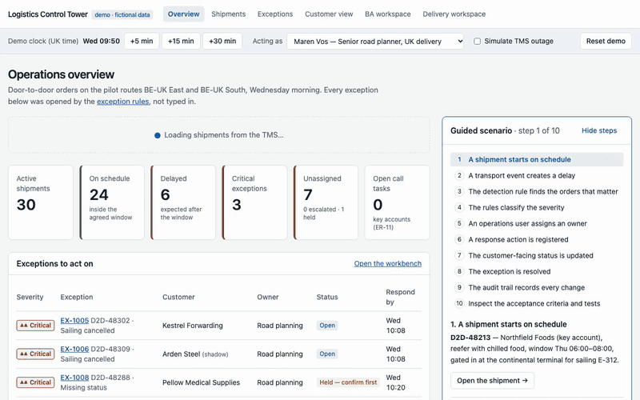

# Shipment exceptions, handled before the customer calls

**How could a short-sea and door-to-door operator tell customers about a delay before they call?**

A business analysis case from opportunity to production readiness — framed as a business case, worked out with the people involved, specified precisely enough to run as tests, built as a working control tower, accepted by the business and brought live in a controlled pilot.

[Live site](https://phlppgdfry.github.io/shipment-exception-management-business-analysis/) · [Control tower](https://phlppgdfry.github.io/shipment-exception-management-business-analysis/control-tower/) · [5-minute tour](https://phlppgdfry.github.io/shipment-exception-management-business-analysis/for/recruiters/) · [Evidence navigator](https://phlppgdfry.github.io/shipment-exception-management-business-analysis/workspace/) · [Case study PDF](portfolio/case-study/case-study.pdf) · [Executive summary PDF](portfolio/executive-summary/executive-summary.pdf) · [Start here](START-HERE.md)

[](https://github.com/phlppgdfry/shipment-exception-management-business-analysis/actions/workflows/ci.yml)

> **Independent portfolio case.** Tidewell Logistics is fictional; it contains no confidential information from any real employer or the hiring company. Workshops, sprints, acceptance testing and the pilot readout are **simulated**; figures are **illustrative assumptions**. The automated tests and the demo are **real**; nothing was deployed in a real organisation. Every artefact carries one of six [evidence labels](portfolio/content/case.json).



*65-second walkthrough of the [control tower](https://phlppgdfry.github.io/shipment-exception-management-business-analysis/control-tower/) ([MP4](https://phlppgdfry.github.io/shipment-exception-management-business-analysis/assets/walkthrough/walkthrough.mp4)).*

## Choose your view

| You are… | Read | Time |
|---|---|---|
| **Recruiter** | [recruiter view](portfolio/views/recruiter-view.md) or the [5-minute tour](https://phlppgdfry.github.io/shipment-exception-management-business-analysis/for/recruiters/) | 90 s – 5 min |
| **Hiring manager** | [hiring manager view](portfolio/views/hiring-manager-view.md) — ambiguity, trade-offs, ownership | 10 min |
| **Architect, developer, tester** | [technical view](portfolio/views/technical-view.md) — boundaries, contract, ADRs, runbook | 15 min |
| **Analyst who wants everything** | [documentation map](docs/00-documentation-map.md) or the [evidence navigator](https://phlppgdfry.github.io/shipment-exception-management-business-analysis/workspace/) | 30+ min |
| **Learning the methods (Dutch)** | [Learning Lab](learning/README.md) — 10 modules, quizzes, competency tasks | ±60 h |

The [role requirement matrix](portfolio/role-requirement-matrix.md) maps a typical IT business analyst profile to evidence **and** to what still needs practical validation.

## The problem

Since its new TMS went live, Tidewell's customers see statuses in a portal — but not whether their **delivery window** is at risk. Only 22% of late deliveries were announced before the window started; "where is my load?" is ±38% of all customer contacts; planners notice delays by chance and copy orders into Excel. Three managers asked for three solutions: a tracking page, e-mails to key accounts, and "nothing that adds work".

The root cause was not a missing screen but **missing rules**: what counts as late, how serious it is, who acts, and who is told.

## The journey

```text
FRAME → DISCOVER → EVENT STORM → MODEL → RULES → PRIORITISE → DESIGN → BUILD → ACCEPT → GO LIVE → MEASURE
```

| Step | What happened | Strongest evidence |
|---|---|---|
| Frame | five whys; four options on weights agreed beforehand; riskiest assumption named; pilot with a stage gate | [business case](docs/01-opportunity/options-and-business-case.md) · [registers](docs/01-opportunity/registers.md) |
| Discover & event storm | contradictions kept; six hotspots, each decided by its owner; "late" got one meaning | [workshop dialogue](docs/03-workshops/workshop-dialogue.md) · [decision log](docs/03-workshops/decision-log.md) |
| Model | BPMN 2.0 with timer boundary events; gap analysis typed by kind of change; UML | [TO-BE](docs/04-process/to-be.md) · [gap analysis](docs/04-process/gap-analysis.md) |
| Rules | 13 rules in one table, as DMN 1.3, with 30 examples that run as tests; DMN proven equal to the code on 912 cases | [rules](docs/05-requirements/exception-rules.md) · [DMN](docs/05-requirements/dmn/exception-decisions.dmn) |
| Prioritise | WSJF with the PO; dependencies sequence; release 2 refined and honestly "not ready" | [prioritisation](docs/06-backlog/prioritisation.md) · [release 2](docs/06-backlog/release-2-edi-status.md) |
| Design | personas, journeys, states, accessibility; eight UX decisions tied to needs | [UX specification](docs/07-design/ux-specification.md) · [handover](docs/07-design/control-tower-handover.md) |
| Build to learn | working control tower on the same rules; found five open questions and a privacy leak | [demo](demo/README.md) · [architecture](docs/12-architecture/README.md) · [ADRs](docs/12-architecture/adr/README.md) |
| Accept | BAT with key users incl. the sceptic; the analyst's own mistake (DEF-04) and the retro action | [BAT log](docs/09-acceptance/bat-log.md) · [test results](docs/09-acceptance/test-results.md) |
| Go live | go/no-go with an owner per line; shadow mode; rollback; runbook; adoption measures | [readiness](docs/10-go-live/release-readiness.md) · [runbook](docs/10-go-live/operations-runbook.md) · [change & adoption](docs/10-go-live/change-and-adoption.md) |
| Measure | pilot vs. control group; business case adjusted, not inflated | [benefits review](docs/11-measure/benefits-review.md) |

## What this demonstrates

| Typical IT business analyst responsibility | Evidence |
|---|---|
| Analyse business needs, challenges and opportunities | [problem](docs/01-opportunity/problem-statement.md) · [business case](docs/01-opportunity/options-and-business-case.md) · [capability map & SWOT](docs/01-opportunity/strategic-analysis.md) |
| Translate needs into user stories, flows and acceptance criteria | [BPMN](docs/04-process/to-be.md) · [stories](docs/06-backlog/user-stories.md) · [executable criteria](docs/06-backlog/features/exception-decision.feature) |
| Facilitate event storming and refinement; design in Figma | [facilitation](docs/03-workshops/workshop-dialogue.md) · [refinement](docs/08-delivery/refinement-log.md) · [design](docs/07-design/design.md) |
| Support the PO in defining and prioritising the backlog | [WSJF](docs/06-backlog/prioritisation.md) · [roadmap](docs/06-backlog/product-vision-and-roadmap.md) · [roles](docs/08-delivery/roles-and-responsibilities.md) |
| Work with developers and architects | [architecture](docs/12-architecture/README.md) · [ADRs](docs/12-architecture/adr/README.md) · [OpenAPI](demo/mock-apis/openapi.yaml) |
| Agile ceremonies, documentation and testing | [sprint plan](docs/08-delivery/sprint-plan.md) · [test strategy](docs/09-acceptance/test-strategy.md) · [traceability](docs/05-requirements/traceability.md) |
| Business Acceptance Testing and end-user documentation | [BAT log](docs/09-acceptance/bat-log.md) · [KB article](docs/10-go-live/support-handover.md) |
| Ready for production, understood by all stakeholders | [go/no-go](docs/10-go-live/release-readiness.md) · [change & adoption](docs/10-go-live/change-and-adoption.md) · [runbook](docs/10-go-live/operations-runbook.md) |

Full mapping, including what is *not* claimed: [EVIDENCE.md](EVIDENCE.md).

## Two layers, one source of truth

The **evidence** lives in `docs/` (analysis), `demo/` (the working control tower) and `tests/`. The **presentation** layer — the [landing page](https://phlppgdfry.github.io/shipment-exception-management-business-analysis/), the evidence navigator, the PDFs, decks and audience views in [`portfolio/`](portfolio/README.md) — is derived from it. The landing page and navigator are generated from one [content manifest](portfolio/content/case.json); CI fails if any path in it is missing or any generated file is stale.

| Folder | Contents |
|---|---|
| [`docs/`](docs/00-documentation-map.md) | the analysis, numbered along the journey (01 opportunity … 13 quality) |
| [`demo/`](demo/README.md) | the control tower (Next.js, TypeScript), deterministic mock data, the OpenAPI contract and examples |
| `site/` | GitHub Pages: landing page, recruiter tour, evidence navigator, learning page, prototype, rule explorer, process, event storming |
| `site/assets/exception-rules.mjs` | the rules as one module — used by the prototype, the rule explorer, the control tower and the tests |
| `tests/` | acceptance examples and DMN consistency against the rule module |
| [`data/`](data/) | Excel workbook with formulas and CSV mirrors |
| [`portfolio/`](portfolio/README.md) | PDFs, decks, audience views, demo scripts, screenshots, walkthrough video, CV and LinkedIn text, content manifest |
| [`learning/`](learning/README.md) | Dutch learning lab, interview preparation, AI provenance |
| `scripts/` | generators (BPMN, DMN, site, learning page, deck) and checks (links, repository gate, test-results recorder) |
| [`PROJECT-ROADMAP.md`](PROJECT-ROADMAP.md) | charter, acceptance criteria for this repository, status and remaining gaps |

## Run and check it locally

Node.js 22+ and Python 3. No credentials, no paid services.

```sh
cd demo/application && npm ci && npm run dev                      # control tower on http://localhost:3000

node --test tests/*.test.mjs                                      # 30 examples + DMN consistency (from the repo root)
python3 scripts/validate_repo.py                                  # deliverables, IDs, traceability, BPMN/DMN, learning lab, manifest
python3 scripts/check-links.py                                    # documentation links
cd demo/application
npm run lint && npm run typecheck && npm test                     # lint, types, unit + contract tests
npm run check:models                                              # BPMN 2.0 / DMN 1.3 against their meta-models
BASE_PATH=/shipment-exception-management-business-analysis/control-tower npm run build
npm run test:e2e && npm run test:site                             # browser + accessibility tests: control tower and case site
```

`node scripts/record-test-results.mjs` runs everything and writes [what actually executed](docs/09-acceptance/test-results.md).

## How this repository was made

The case and the materials were built with AI assistance (Claude). What the owner has reviewed, changed and can do independently is tracked per artefact, and starts at zero — because files existing proves nothing. That table and the interview preparation are kept **privately**, outside this public repository; they are available on request in a conversation.

## Notes on realism and assumptions

The organisation, people, numbers, workshops and BAT are fictional; their shape is not. The case keeps the mess a real team meets: three stakeholders asking for three solutions, a SaaS supplier whose roadmap you cannot count on, hauliers who do not use the app, 28% of orders without a delivery window, an account manager and a planner who want opposite things, a GDPR question about consignees, a planner in Belgium serving consignees in the UK, and a BAT defect that came from my own refinement answer. The rule module exists to prove the rules are precise enough to build and test — not to suggest that the analyst writes production code.

Companion case on the same fictional operator, from the functional analyst's side: [late booking amendments](https://github.com/phlppgdfry/shortsea-booking-functional-analysis).
