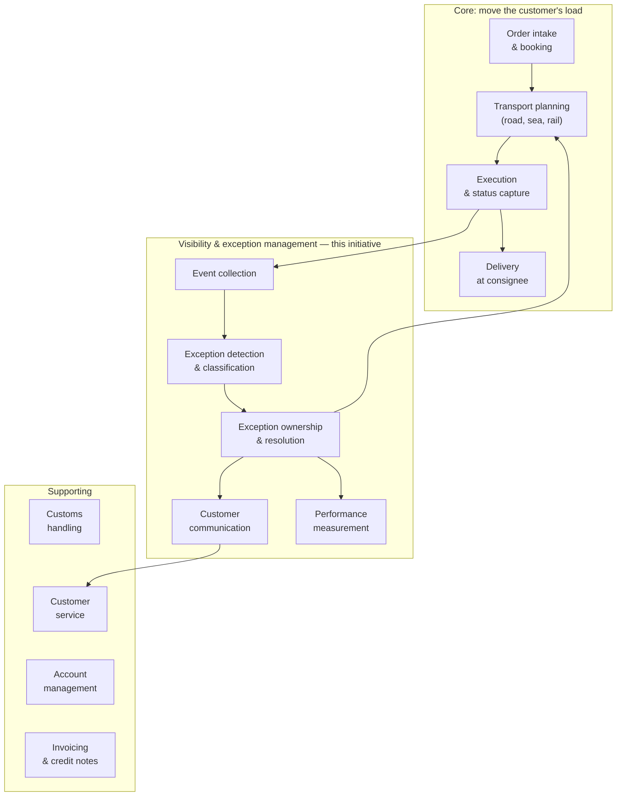

# Strategic analysis — capabilities and SWOT

> **What this is:** which business capabilities this initiative touches, how mature they are today, and a SWOT of the organisation's position for this change. **For:** sponsor, PO and architects who ask "does this fit the bigger picture?". **Previous:** [problem statement](problem-statement.md) · **Next:** [options and business case](options-and-business-case.md).

*Fictional organisation. Maturity scores are the analyst's assessment after discovery, not a formal audit.*

## Capability map (door-to-door division)

A capability is **what** the business does, independent of who does it or which system supports it. Mapping the problem to capabilities stops the conversation from jumping to "we need a new screen".

| Capability | Today (1–5) | Target R1 | What is missing today | Addressed by |
|---|:---:|:---:|---|---|
| Event collection | 3 | 4 | Statuses arrive in the TMS, but half of the hauliers do not use the app | EN-1; haulier onboarding in R2 (D-04) |
| **Exception detection & classification** | **1** | **4** | No definition of "late", no severity | ER-01 – ER-05, US-01 |
| **Exception ownership & resolution** | **1** | **4** | No owner per cause; Excel sheet; no reason recorded | ER-08, ER-09, US-02 – US-04 |
| **Customer communication** | **2** | **4** | Only when an account manager happens to know | ER-10 – ER-13, US-05, US-07, US-10, US-11 |
| Performance measurement | 1 | 3 | Baselines needed a manual sample | FR-12, US-13 |
| Order intake & booking | 4 | 4 | 28% of orders without a delivery window | EN-2 (data quality) |
| Customs handling | 3 | 3 | Owner clear, customer not asked to act in time | R2 (US-09) |

*Scale: 1 = ad hoc, depends on individuals · 2 = repeatable for some customers · 3 = defined and shared · 4 = measured · 5 = continuously improved.*

**Reading the map:** the weak capabilities sit in one band (detection → ownership → communication). That is why the recommended option is a thin policy layer on top of the TMS ([D-03](../03-workshops/decision-log.md#d-03)) and not a new tracking platform: the TMS already covers event collection reasonably well.

## SWOT — for this initiative

| | Helpful | Harmful |
|---|---|---|
| **Internal** | **Strengths** · TMS live with webhooks and an API (A-01) · planners know the customers and the routes · a Scrum team with a PO already owns "Customer Visibility" · sponsor has made predictability a half-year priority | **Weaknesses** · 28% of orders have no delivery window (A-02) · statuses depend on haulier discipline · no shared definition of late · customer-service tagging is not standard, so baselines are samples · one more component for application support (D-03) |
| **External** | **Opportunities** · customers explicitly ask for earlier bad news ("rather at 10 than no news at 4") · event-based visibility standards make structured statuses more common (S-05, [sources](../02-discovery/sources.md)) · electronic freight information (eFTI, S-07) will push data quality up over time | **Threats** · TMS supplier may ship its own exception module (D-03 reviewed quarterly) · competitors offering parcel-style tracking raise expectations · message fatigue if notifications are noisy (O2 test) · customs regime changes on UK flows (S-08) |

### What the SWOT changed

| SWOT item | Consequence in the case |
|---|---|
| W: 28% of orders without a window | EN-2 got the highest WSJF score; FR-03 default rule ([D-06](../03-workshops/decision-log.md#d-06)) |
| W: haulier status discipline | Missing status is **held**, not notified ([ER-07](../05-requirements/exception-rules.md)) |
| T: supplier exception module | Rules kept in one portable module; quarterly review ([D-03](../03-workshops/decision-log.md#d-03)) |
| T: message fatigue | Throttling and severity thresholds ([ER-10, ER-12](../05-requirements/exception-rules.md)); K7 and K8 as KPIs |
| O: customers want earlier bad news | Pilot customers co-test the messages (BAT-07) |

---

[Documentation map](../00-documentation-map.md) · Next: [Options and business case →](options-and-business-case.md)
