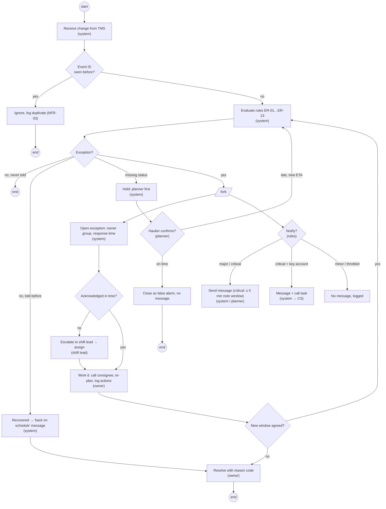

# Process gap analysis and exception-handling flow

> **What this is:** the gaps between the AS-IS and the TO-BE, step by step, with the change type for each and why it improves the process — plus a UML activity diagram of how one exception is handled, including its alternative paths. **For:** PO, key users, change management, testers. **Previous:** [TO-BE process](to-be.md) · **Next:** [UML models](uml.md).

## Gap analysis

| Step | AS-IS | TO-BE | Gap | Change type | Who is affected | Pain fixed | Measured by |
|---|---|---|---|---|---|---|---|
| Detect | Planner notices by chance (phone, sailing system screen) | Every change is evaluated within 2 min | No systematic detection | **system** (rules) | planners | P1 | K2, NFR-01 |
| Decide if it matters | Gut feeling; three teams count "late" differently | One definition: after the end of the agreed window; severity by minutes | No shared definition, no severity | **policy** (D-01, D-02) + system | planners, CS, AMs | P2 | K7 false alarms |
| Find affected orders | Excel "disruption sheet", copied by hand | Only exceptions appear, sorted by urgency | Manual lookup | **system** (workbench) | planners | P3 | guardrail: workload |
| Own it | Whoever picks up the phone | Owner group by cause; response time; escalation | No owner, no response time | **organisation** (ER-08, ER-09) + system | planners, terminal, customs, shift lead | P2 | K6 |
| Tell the customer | Only key accounts whose AM happens to know | Major/critical: proactive message; key account critical: call | No trigger, no channel, inconsistent | **policy** + system | customers, CS, AMs | P4, P5 | K1, K3 |
| Missing status | Ignored or an alarm | Held until the planner confirms | No rule | **policy** (D-04) | planners, customers | — (new) | K7 |
| Avoid message storms | n/a (few messages) | One message per order per 2 h unless worse | — (would appear with automation) | **policy** (ER-12) | customers | — (prevented) | K8 |
| Close | Not recorded | Mandatory reason code | No learning loop | **process** + system | planners, finance | P6 | reason completeness |
| Measure | Manual sample of 60 orders | Daily export; control group | No data | **system** (US-13) | PO, Head of CS | — | stage gate |

**Change types** matter for planning: a *system* gap is a backlog item; a *policy* gap needs a decision owner (decision log); an *organisation* gap needs the line manager, training and the communication plan. Of nine gaps, only four are pure system gaps — which is why the case has a decision log, a training plan and a communication plan, not only a backlog.

## Why the TO-BE is better (improvement rationale)

1. **Rules before screens.** The root cause was the absence of a definition, not of a tool ([problem statement](../01-opportunity/problem-statement.md#root-causes-5-whys-on-the-customer-hears-it-too-late)). Every TO-BE step depends on ER-01.
2. **Fewer, better signals.** Of ±9 status changes per order, ±0.3 matter to the customer (O2 test). The TO-BE moves effort from scanning changes to acting on exceptions.
3. **One owner, one clock.** Response times with escalation replace "someone will notice".
4. **The customer hears it once, from us.** One message with a new ETA and a next step instead of a call to CS.
5. **It learns.** Reason codes and the export turn credit notes into causes.

## Exception handling — UML activity diagram

One exception from detection to closure, with the decisions and parallel work. Swimlanes are shown as the actor in brackets; Mermaid has no native activity-diagram swimlanes, so decision nodes use the flowchart diamond.

### Exception flows (alternative and failure paths)

| ID | Path | Trigger | Handling | Reference |
|---|---|---|---|---|
| EF-1 | Duplicate event | same event ID | ignored, logged | NFR-03, TC-08 |
| EF-2 | Recovers before anyone acted | ETA back inside the window | recovered; message only if told before | ER-13, OQ-01 |
| EF-3 | Missing status, haulier confirms on time | planner action | closed as false alarm; no message | ER-07, TC-18 |
| EF-4 | Not acknowledged in time | clock | escalated to shift lead | ER-09, TC-10 |
| EF-5 | Order recovers while a critical message waits for a note | re-plan within 5 min | pending message withdrawn | OQ-03, TC-21 |
| EF-6 | Gets worse within 2 h | new evaluation | new message despite throttle | AC-07.2 |
| EF-7 | Message bounces | notification service | flag + call task | FR-09 |
| EF-8 | TMS unavailable | API error | retry, then alert; workbench shows last data | NFR-04, TC-26 |
| EF-9 | No window on the order | evaluation | assume planned ETA + 2 h, flag | FR-03, D-06 |

---

[Documentation map](../00-documentation-map.md) · Next: [UML models →](uml.md)
