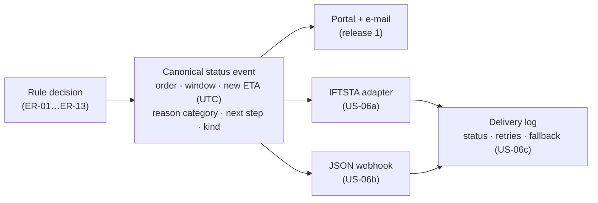

# Release 2 — status messages for EDI/API customers (US-06), refined

> **What this is:** the second iteration of the product: US-06 taken from a one-line headline to stories that are ready for a sprint — discovery questions, a split into three slices, the message mapping, acceptance criteria and the open questions with an owner. **For:** PO, team, the EDI/integration specialist, the largest forwarder. **Previous:** [user stories](user-stories.md) · **Next:** [prioritisation](prioritisation.md).

*Fictional organisation; refinement simulated. Release 2 is conditional on the stage gate ([D-07](../03-workshops/decision-log.md#d-07)). Acceptance criteria: [`features/release-2-edi-status.feature`](features/release-2-edi-status.feature) — specified, not yet executable.*

## Why this story, and why now

In release 1 the largest forwarder (Kestrel Forwarding, a pilot customer) gets portal + e-mail messages, like everyone else. Their operators do not read either: they work in their own TMS, which receives our bookings and statuses by EDI. The PO moved US-06 to release 2 because US-08 (no false alarms) mattered more for trust in week 1 ([prioritisation](prioritisation.md#trade-offs-the-po-made)). The illustrative pilot readout ([benefits review](../11-measure/benefits-review.md)) recommends US-06 for release 2.

**Goal of the release-2 increment:** EDI/API customers receive the same decision — new ETA, reason, next step — **in their own system**, at the same moment and with the same throttling as portal customers.

## What refinement had to answer first

| # | Question | Asked to | Answer (simulated) | Became |
|---|---|---|---|---|
| R2-Q1 | Which format do EDI customers expect for a status update? | Kestrel's EDI team; our integration specialist | Most use UN/EDIFACT IFTSTA (international multimodal status report); two large customers prefer a JSON webhook | slice 06a (IFTSTA) and 06b (JSON) |
| R2-Q2 | Do they want every status, or only exceptions? | Kestrel transport manager | "Only what changes our plan — we already get milestones" | same rules as R1 (ER-10); minor only if opted in |
| R2-Q3 | Which time do they expect — UTC or local? | EDI team | UTC with offset in the message; their system converts | AC-06.3; lesson of DEF-01 |
| R2-Q4 | What if their endpoint is down? | integration specialist | retry with back-off for 2 h, then call task for CS and an e-mail fallback | AC-06.7, AC-06.8 |
| R2-Q5 | Do EDI customers still get e-mail? | PO | not by default — one channel per customer, to avoid two messages for one event | AC-06.5 |
| R2-Q6 | Can a reason category be mapped to their codes? | EDI team | only four of our six categories have a clear code; the rest go as free text | **open** — see below |

## Split into slices

The original headline ("As an EDI/API customer I receive a status message for major/critical exceptions", 8 points) is too big for half a sprint and mixes two technologies. Split by value and risk, not by layer:

| Slice | Story | Size (team, simulated) | Why this order |
|---|---|---:|---|
| **US-06a** | *As a forwarder using EDI, I want a status message in my own system when my delivery window is at risk, so that my operators see it where they work.* — IFTSTA, delay and recovery | 5 | the largest customer; the riskiest mapping |
| **US-06b** | *As a customer with an API, I want the same decision as a JSON webhook, so that I can react automatically.* | 3 | reuses the canonical event from 06a |
| **US-06c** | *As customer service, I want to see which channel a message went through and whether it was delivered, so that I can answer "did you tell us?" in one look.* | 2 | support readiness; needed before go-live |

Total 10 points (was estimated 8 as one item — splitting surfaced the support slice).

## One decision, many channels

The rules decide **once**; a channel adapter only translates. That keeps throttling, hold and recovery identical across channels (the lesson of [DEF-04](../09-acceptance/bat-log.md)).

### Canonical event → IFTSTA (outline)

| Canonical field | IFTSTA segment (outline) | Note |
|---|---|---|
| order reference | RFF (reference) | the customer's own reference too, if known |
| kind (delay / recovery / action required) | STS (status) | **code values to agree per customer** — R2-Q6 |
| agreed window, new ETA | DTM (date/time) | UTC with offset (R2-Q3) |
| reason category | STS reason / FTX free text | four categories mapped, two as text (R2-Q6) |
| next step | FTX (free text) | plain language, never driver data (NFR-05) |
| message ID | BGM (message header) / UNH | idempotency on the receiver's side |

*Outline only: segment usage and code lists are confirmed with each customer's EDI team in a mapping workshop (time-boxed, before sprint planning). The BA owns the mapping table; the integration specialist owns the implementation guide.*

## Non-functional requirements for release 2

| ID (proposed) | Requirement | Verification |
|---|---|---|
| R2-NFR-a | Same timeliness as release 1: message within 5 min of the exception opening (NFR-01) | timestamps in the delivery log |
| R2-NFR-b | At-least-once delivery with idempotent message IDs; the customer never sees the same update twice | replay test with the customer's test endpoint |
| R2-NFR-c | Retry with back-off for 2 h; then fallback e-mail + call task | test with the endpoint switched off |
| R2-NFR-d | Per-customer channel configuration without a release | configuration test in BAT |

*Proposed IDs; they get FR/NFR numbers when the PO accepts the release-2 scope.*

## Open questions

| Question | Owner | Needed by |
|---|---|---|
| R2-Q6: which reason categories map to which status codes, per customer? | integration specialist with each EDI customer | mapping workshop, before sprint planning |
| Does a customs hold (US-09) go by EDI too, or only to the customs contact? | customs desk lead with PO | refinement of US-09 |
| Who monitors failed deliveries at night? | application support lead | before go-live |

## Definition of Ready check (for US-06a)

- [x] user, need and "so that" understood outside IT
- [x] linked to requirements and rules (ER-10, ER-12, ER-13, NFR-01, NFR-05)
- [x] acceptance criteria with boundary and failure cases ([feature file](features/release-2-edi-status.feature))
- [ ] **R2-Q6 answered** — not ready until the mapping workshop is done
- [x] estimated (5)
- [ ] dependency: test endpoint from Kestrel's EDI team — requested

**Verdict:** not ready yet — two open items. That is the point of the page: the analyst shows what is missing before the sprint, instead of discovering it in BAT.

---

[Documentation map](../00-documentation-map.md) · Next: [Prioritisation →](prioritisation.md)
