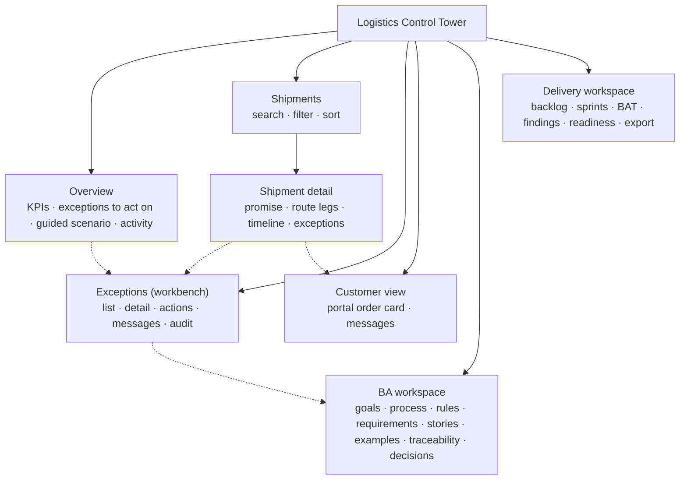

# UX specification — Logistics Control Tower

> **What this is:** the information architecture, user flows, wireframes, design system, interaction rules, states and accessibility targets behind the [control tower demo](../../demo/README.md), and the reasoning for each key decision. **For:** designers, developers, testers, PO. **Previous:** [personas and journeys](personas-and-journeys.md) · **Next:** [design](design.md).

## Design artefacts and where they live

| Artefact | Tool | Status |
|---|---|---|
| Planner workbench, customer e-mail, portal status card, design decisions, reusable "exception row" component | Figma — [file](https://www.figma.com/design/W6hussB5UmQf2wwWEkeJnI) | created earlier in the case; exports in [`figma/`](figma/) |
| Event storming board | FigJam — [board](https://www.figma.com/board/xebYRE5Vpm5v2NCc2tuDQe) | created earlier in the case |
| Control tower screens (6 routes) | code (Next.js) — screenshots in [`portfolio/screenshots/`](../../portfolio/screenshots/) | **not in Figma.** The coded demo was designed directly in code on the tokens below |
| Low-fidelity wireframes | text (below) | in this document |

**How to bring the control tower into Figma:** open the live demo and use Figma's *html.to.design* or a screenshot import per route; the tokens below map 1:1 to Figma variables (one collection "colour", modes *light* and *dark*). This was not done in this repository; do not assume a Figma file of the control tower exists.

## Information architecture



Operational screens (Overview, Shipments, Exceptions) come first in the navigation; the customer view sits between operations and the analysis workspaces because it is the *outcome* of the operational work. The two workspaces exist for reviewers — in the real product they would be documentation, not screens.

## Key user flows

| Flow | Steps | Success criterion |
|---|---|---|
| **F1 Act on the most urgent exception** (Maren) | Exceptions → first card → read "why" → Acknowledge → (optional) note + send → log action → re-plan or resolve | ≤ 4 clicks from the list to "acknowledged"; nothing to type unless she wants to |
| **F2 Clear the escalations** (Priya) | Overview "Unassigned" tile → filtered list → exception → Assign | escalated items visible without searching |
| **F3 Answer a customer call** (Sara) | Shipments → search order → exception → messages (what was told, when) | answer in one screen |
| **F4 See my delivery** (Daniel) | Customer view → order reference → card | headline answers "is my window at risk?" in one line |
| **F5 Confirm a missing status** (Maren) | Exception (held) → "on time" or "delay + new ETA" | no customer message before confirmation |

## Low-fidelity wireframes

**Workbench (desktop)** — list left, detail right; on mobile the detail follows the list.

```text
┌──────────────────────────────────────────────────────────────────────────────────┐
│ Logistics Control Tower   Overview  Shipments  [Exceptions]  Customer  BA  Delivery│
│ Clock Wed 09:50 [+5][+15][+30]   Acting as [Maren ▾]   ☐ TMS outage   [Reset]     │
├───────────────────────────┬──────────────────────────────────────────────────────┤
│ Show[Active▾] Owner[All▾] │ EX-1012  ▲▲ Critical  Open           Shipment D2D-…  │
│ Severity[All▾] ☐Unassigned│ Cause · Customer · Window → expected · Owner · Due   │
├───────────────────────────┤ ┌ Why the rules decided this ──────────────────────┐ │
│ ▲▲ Critical  Open  EX-1012│ │ ER-02 …  ER-04 …  ER-11 …   → examples & tests   │ │
│ D2D-48213 · Sailing delay │ └──────────────────────────────────────────────────┘ │
│ Northfield · Road planning│ What to do: [Acknowledge — I own this]               │
│ Respond by 10:22 · 30 min │ Customer messages: MSG-… waiting for note [Send now] │
├───────────────────────────┤ Call tasks · Evaluation history · Audit trail        │
│ ▲ Major  Open   EX-1001 … │                                                      │
└───────────────────────────┴──────────────────────────────────────────────────────┘
```

**Customer portal card**

```text
┌─────────────────────────────────────┐
│ Northfield Foods · order D2D-48213  │
│ [Significant delay]                 │
│ Significant delay: expected Thu 12:40│
│ Progress        At the departure terminal
│ Your window     Thu 06:00–08:00     │
│ Expected        Thu 12:40           │
│ Reason          Sailing delayed     │
│ Next step       Your planner is working on a new slot…
│ “Message from your planner: …”      │
│ Times are UK local time.            │
└─────────────────────────────────────┘
```

## Design system

**Principle: restrained.** One accent colour for actions and links; neutral surfaces; colour reserved for meaning (severity, status). Every coloured signal also has a text label and, for severity, a shape (▲▲ critical, ▲ major, ● minor) — colour is never the only signal (WCAG 1.4.1).

| Token | Light | Dark | Use |
|---|---|---|---|
| `--bg` / `--surface` / `--surface-2` | #f6f7f9 / #ffffff / #f1f3f6 | #0f141a / #161d25 / #1d2630 | page, cards, quiet areas |
| `--text` / `--text-muted` | #17202b / #556171 | #e7ecf2 / #a3afbd | body, secondary |
| `--accent` | #0b5cad | #6fb2f2 | primary buttons, links, focus |
| `--critical` (+ soft) | #a4161a | #ff8a8a | critical severity, errors, escalated |
| `--major` (+ soft) | #8a4b00 | #ffbf66 | major severity, held, pending |
| `--minor` (+ soft) | #3d4b5c | #c2ccd8 | minor severity |
| `--ok` (+ soft) | #1c6b3a | #7fd49b | on time, recovered, sent |

Source of truth: [`globals.css`](../../demo/application/src/app/globals.css). Components: [`ui.tsx`](../../demo/application/src/components/ui.tsx) — `SeverityBadge`, `StatusBadge`, `MessageStatusBadge`, `KpiTile`, `Card`, `Button` (primary / secondary / danger / ghost), `Field`, `LoadingState`, `ErrorState`, `EmptyState`, `InlineError`, `RuleChip`.

Typography: system font stack (no web-font download, fast and legible on planning PCs); tabular numerals for times and counts so columns align.

## States

| State | Where | Behaviour |
|---|---|---|
| **Loading** | every read through the API (shipments, exceptions, tracking) | dashed box with "Loading …" and `role="status"`; old data stays visible while refreshing |
| **Empty** | no matching shipments; no exceptions; no messages | says *why* and what to do ("Delays inside the agreed window are not exceptions (ER-01)") |
| **Error (read)** | TMS outage (demo switch) | `role="alert"` box with the problem title and detail and **Try again**; the overview says the workbench keeps working on the last data |
| **Error (command)** | refused action (403/409/422) | inline alert next to the action with the API's problem detail, e.g. "A note is required when the reason is "other" (AC-04.3)" |
| **Read-only** | user outside the owner group | explanation of *why* (NFR-06), actions disabled — not hidden, so the user learns who can act |
| **Pending** | command in flight | buttons disabled to prevent double submission; commands also carry an `Idempotency-Key` |

## Interaction specifications

| Element | Rule |
|---|---|
| Workbench order | critical → major → minor; within a severity, earliest due time; then oldest (AC-03.1). Implemented in `sortForWorkbench` |
| Due time | "Respond by Wed 10:22 · 18 min left"; amber ≤ 10 min, red and "overdue" after; only for open, held and escalated |
| Critical message | waits up to 5 min for a note, then is sent automatically; "Send now" sends immediately (D-08) |
| Resolve | reason required; note required for "other"; the field label changes to say so |
| Re-plan | date-time inputs in UK local time, prefilled around the current ETA |
| Destructive demo action | "Reset demo" asks for confirmation inline (no browser dialog) |
| Links to documents | open on GitHub in a new tab and say so to screen readers |

## Accessibility

Target: **WCAG 2.2 AA**. Checked automatically with axe-core on every route, desktop and mobile, in CI (no serious or critical violations allowed) — see [test results](../09-acceptance/test-results.md).

- Landmarks (`header`, `nav`, `main`, `footer`), one `h1` per page, skip link, `aria-current` on navigation and the scenario step.
- All form controls labelled; errors announced with `role="alert"`; the demo clock is `aria-live`.
- Tables have captions and header scopes; wide tables are focusable scroll regions with a label.
- Visible focus ring (3 px, accent colour); `prefers-reduced-motion` respected; dark mode via `prefers-color-scheme`.
- **Not verified:** a walkthrough with a screen-reader user (TC-M6), and a usability test with real users — prepared in the [usability test plan](usability-test-plan.md), not yet run. Automated checks find roughly a third of issues; they are a floor, not a certificate.

## UX decisions and the need behind each

| ID | Decision | User need / objective | Alternative considered |
|---|---|---|---|
| UX-1 | List + detail on one screen | Maren works the list top-down without losing her place (F1) | separate detail page — loses context |
| UX-2 | "Why the rules decided this" on every exception, in plain words with rule IDs | Trust in severity is the moment that matters (journey stage 2); support can explain decisions (NFR-08) | show only the severity — planners second-guess it |
| UX-3 | Disabled-with-reason instead of hidden actions | Users learn who can act; fewer "it's broken" tickets | hide actions — confusing in a shared screen |
| UX-4 | Customer card built only from sent messages | Daniel sees one consistent story; nothing internal leaks (NFR-05) | show the live ETA — would contradict the last message and invite calls |
| UX-5 | Severity = shape + text + colour | Colour-blind users; printed screenshots in hypercare | colour only |
| UX-6 | Times labelled with their zone; customer messages in the consignee's local (UK) time | DEF-01 (UTC in the e-mail); refinement Q10 | the demo also shows UK time in the **workbench**, a simplification: Q10 decided the planner's own local time there (a planner in Belgium would see +1 h) |
| UX-7 | Overview tiles link to filtered lists | Priya goes from a number to the work in one click (F2) | static numbers |
| UX-8 | No live map | Customers need the window consequence, not the position (prioritisation trade-off) | map as the centrepiece — attractive, answers the wrong question |

---

[Documentation map](../00-documentation-map.md) · Next: [Design →](design.md)
