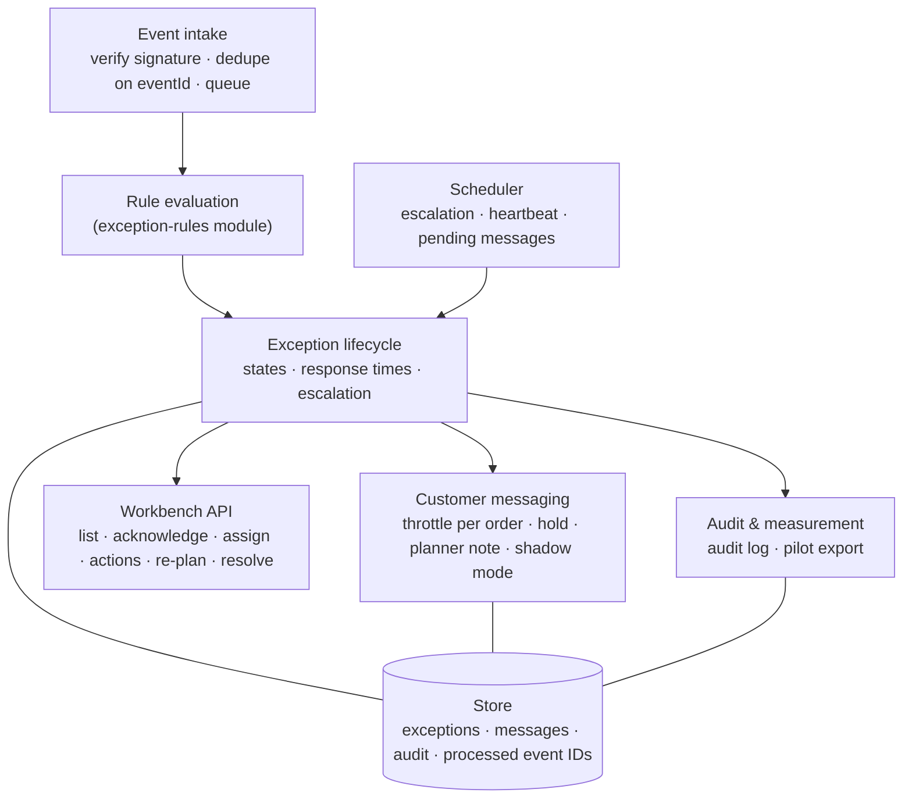

# Solution architecture — overview

> **What this is:** the conceptual architecture of the exception component, written so a business analyst can discuss it with developers and architects. It keeps two things apart: what is **proposed** for the real organisation, and what is **implemented** in the demo. **For:** IT architect, developers, application support, PO. **Previous:** [UML models](../04-process/uml.md) · **Next:** [integration and API](integration-and-api.md).

*Fictional organisation. The proposed architecture has not been built or deployed; the demo is a browser-only implementation of its behaviour.*

## The decision this architecture follows

[D-03](../03-workshops/decision-log.md#d-03): build a **small** exception component next to the TMS — rules, work list, messages — instead of waiting for the supplier or buying a visibility platform. "Small" is the design constraint: no copy of order data beyond what the rules need, no new planning system, no event platform for its own sake.

## System context

```mermaid
flowchart LR
  subgraph EXT ["Outside Tidewell"]
    CUST["Customer<br/>(shipper, forwarder)"]
    HAUL["Hauliers<br/>(app or phone)"]
  end
  subgraph TW ["Tidewell"]
    TMS["TMS (SaaS)<br/>orders · windows · statuses · portal"]
    SAIL["Booking & sailing system"]
    TOS["Terminal operating system"]
    EXC["<b>Exception component</b><br/>(this case)"]
    NOTIF["Notification service<br/>e-mail + portal messages"]
    CS["Customer service tool"]
    IDP["Identity provider<br/>(staff + portal sign-in)"]
    MON["Monitoring & logs"]
  end
  SAIL -->|sailing times, delays| TMS
  TOS -->|gate, discharge| TMS
  HAUL -->|status, ETA| TMS
  TMS -->|webhook: change events| EXC
  EXC -->|REST: read order, window, profile| TMS
  EXC -->|order note| TMS
  EXC -->|send message| NOTIF
  NOTIF -->|e-mail| CUST
  EXC -->|tracking card| TMS
  TMS -->|portal| CUST
  EXC -->|call task (R1: e-mail to CS queue)| CS
  IDP -.->|tokens| EXC
  EXC -.->|metrics, alerts| MON
```

| Neighbour | Direction | What crosses | Owner |
|---|---|---|---|
| TMS (SaaS) | in (webhook) and out (REST) | change events; order, window, cargo and customer profile; order notes | TMS PO + supplier |
| Notification service | out | message to send, with channel and template | Notification service team |
| Customer service tool | out | call task (R1: e-mail to a queue, DEP-04) | CS tooling |
| Identity provider | in | signed tokens with roles | IT security |
| Monitoring | out | metrics, heartbeat alert (NFR-04), structured logs | Application support |

## Logical components (proposed)



| Component | Responsibility | Requirement |
|---|---|---|
| Event intake | Accept the TMS webhook within 5 s; verify the signature; ignore an event ID seen before; queue for evaluation | EN-1, NFR-03 |
| Rule evaluation | Compute lateness against the window (assumed if missing) and apply ER-01 – ER-13 | FR-01, FR-03, US-01 |
| Exception lifecycle | Open, update, recover, close; response times; escalation | FR-02, FR-07, US-02, US-03 |
| Customer messaging | Decide and send; throttle per order; hold for missing status; planner note window; shadow mode for non-pilot customers | FR-06, FR-08, FR-10, FR-11, FR-14 |
| Workbench API | The commands people give; role checks | FR-04, FR-05, NFR-06 |
| Audit & measurement | Who/what/when/which rules; daily export | FR-12, NFR-08, US-13 |
| Scheduler | Time-based work: escalation, pending messages, webhook heartbeat | ER-09, D-08, NFR-04 |

## Proposed vs. implemented in the demo

| Concern | Proposed for Tidewell | Implemented in the demo | Why the difference |
|---|---|---|---|
| Runtime | Small service (any mainstream stack the team supports), one database | Browser only: TypeScript engine + mock API in `demo/application` | A reviewer can open it without installing anything |
| Inbound events | TMS webhooks, signed; queue; retries | `postTmsEvent()` on the mock API; scripted morning events | No TMS to connect to |
| Rules | `exception-rules` module, parameters as configuration (NFR-09) | **The same module** (`site/assets/exception-rules.mjs`) | Identical on purpose — the rules are the product |
| Persistence | Relational store with audit table | Browser `sessionStorage` (per tab) | Demo only |
| Identity and roles | OIDC sign-in, roles from the identity provider | "Acting as" switch; the same role checks in the engine | No identity provider |
| Messages | Notification service sends e-mail and portal messages | Messages are recorded and shown in the customer view | Nothing is ever sent |
| Time | Real clock; scheduler | Demo clock with +5/+15/+30 min | To show escalation and the planner-note window in seconds |
| Observability | Metrics, structured logs, heartbeat alert | Audit trail on screen; "Simulate TMS outage" shows the error path | — |
| API contract | [OpenAPI](../../demo/mock-apis/openapi.yaml) | Mock API methods follow the contract; a [contract test](../../demo/application/tests/unit/contract.test.ts) checks responses and examples against it | — |

**What is deliberately not proposed:** a message broker or event-streaming platform (one webhook source, modest volume: ±1,600 orders a week), microservices (one component, one team), machine-learning ETA prediction (parked, D-05/parking lot), a copy of the TMS order database.

## Open questions found while building the demo

Building the demo was a test of the specification. These are the gaps it exposed, written as questions for the owners. In the case they would go to refinement; the demo implements the proposal in brackets.

| ID | Question | Owner | Demo's proposal |
|---|---|---|---|
| OQ-01 | An exception recovers **before anyone acknowledged it**. The state diagram only had Acknowledged → Recovered. | PO | Open/Escalated → Recovered allowed; no message unless the customer was told (ER-13). Added to the [state diagram](../04-process/uml.md#exception-lifecycle-uml-state-diagram) |
| OQ-02 | A **held** (missing status) exception passes its response time. Escalate, or keep waiting for the haulier? | Road planning lead | **Decided in [D-09](../03-workshops/decision-log.md#d-09):** escalate to the shift lead, keep the customer message held |
| OQ-03 | A critical message is **waiting for the planner note** (D-08) when the order recovers. Send, or withdraw? | PO | Withdraw it; the customer never hears about a delay that no longer exists |
| OQ-04 | A recovered order becomes **late again**. Same exception or a new one? | PO | Same exception reopens (Recovered → Open/Acknowledged), with full history |
| OQ-05 | A cancelled sailing moves the order to the next sailing — is that the planner's decision or automatic? | Road planning lead | Automatic in the demo (replacement sailing from the event); planner can re-plan |

These were found by implementing, not by reviewing — the same lesson as BAT: "the stories were satisfied, the need was not".

## Further reading

- [Integration and API](integration-and-api.md) — events, contract, idempotency, retries, error handling
- [Data model and state machines](data-model-and-states.md)
- [Security, privacy, observability and data quality](security-privacy-observability.md)

---

[Documentation map](../00-documentation-map.md) · Next: [Integration and API →](integration-and-api.md)
