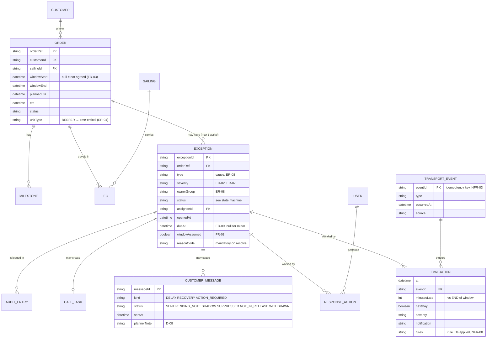
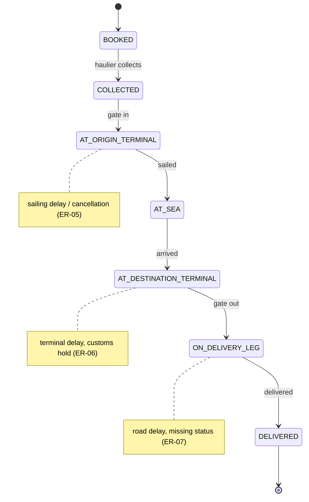
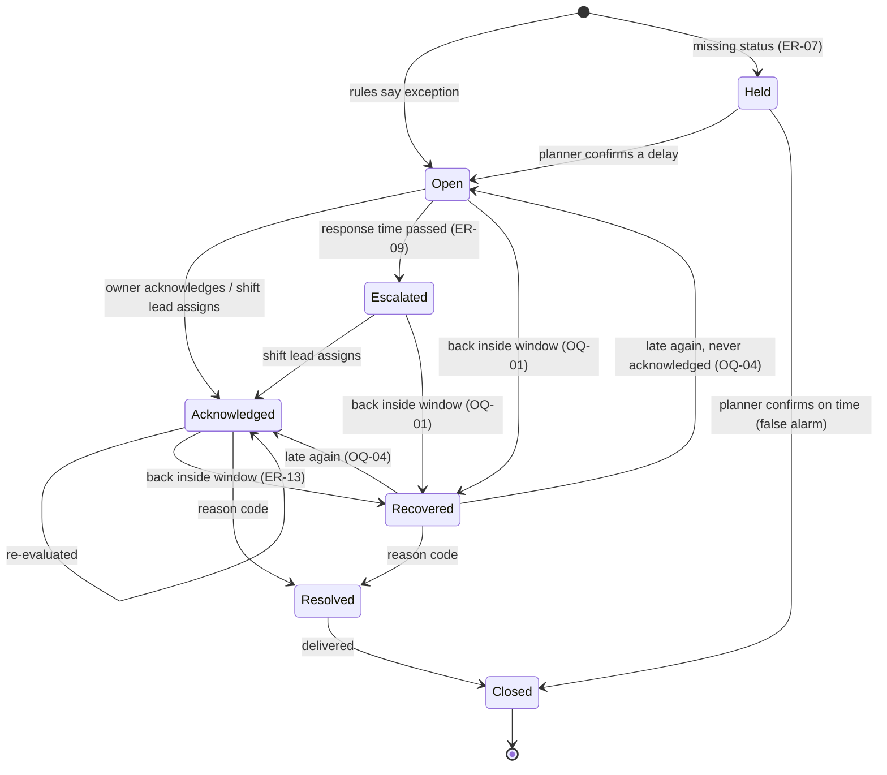

# Data model and state machines

> **What this is:** the information the exception component keeps, how it relates to the TMS's data, and the life cycles of a shipment and an exception. **For:** developers, testers, data and reporting colleagues. **Previous:** [integration and API](integration-and-api.md) · **Next:** [security, privacy, observability](security-privacy-observability.md).

## Who owns which data

The TMS stays the **system of record** for orders, windows, statuses and customers. The exception component owns only what the TMS has no place for: exceptions, the decisions behind them, customer messages, call tasks and the audit trail (D-03: "no copy of the order data beyond what the rules need").

| Data | System of record | The component keeps |
|---|---|---|
| Order, consignee, cargo type | TMS | order reference; reads the rest when evaluating |
| Delivery window | TMS | nothing (re-plans are written in the TMS; the demo stores them locally) |
| Status, ETA | TMS (fed by hauliers, terminal, sailing system) | the values used in each **evaluation**, for audit |
| Customer profile (key account, pilot, preferences, contact) | TMS / CRM | nothing; read per evaluation |
| Exception, evaluation, response action | **component** | all |
| Customer message, call task | **component** (sending by the notification service) | all |
| Audit entries, processed event IDs | **component** | all |

## Logical data model

### Key definitions (the ones people argue about)

| Field | Definition | Why it matters |
|---|---|---|
| `minutesLate` | expected delivery **minus the end** of the agreed window; ≤ 0 means inside | The single most important definition (D-01). Not "minus planned ETA". |
| `nextDay` | expected delivery falls on a later **UK calendar day** than the window end | ER-03; computed in Europe/London, not UTC (lesson of DEF-01) |
| `windowAssumed` | no window agreed → end = planned ETA + 2 h | FR-03; shown to planners so they know the judgement is weaker |
| `dueAt` | opened + response time (30 min critical, 2 h major) | ER-09; drives escalation |
| `reasonCode` | why the exception ended | BR-5: "we pay, but we don't learn" |

## Shipment state machine

The shipment's status comes from the TMS; the component only reads it. Shown for orientation, because testers need to know which statuses can carry an exception.

## Exception state machine

Implemented exactly as `TRANSITIONS` in [`engine.ts`](../../demo/application/src/domain/engine.ts); a unit test checks that every state is reachable and closed is final.

| From → to | Trigger | Who | Guard | Test |
|---|---|---|---|---|
| — → Open | evaluation says exception | system | not missing status | AC-01.3 … AC-02.1 |
| — → Held | missing status | system | — | AC-08.1, AC-08.2 |
| Held → Open | confirm delay + new ETA | owner group / shift lead | new ETA given | lifecycle test "confirmed delay" |
| Held → Closed | confirm on time | owner group / shift lead | — | lifecycle test, e2e "held" |
| Open → Acknowledged | acknowledge | owner group | — | AC-04.1 |
| Open/Escalated → Acknowledged | assign | shift lead only | assignee in owner group | AC-03.5, e2e escalation |
| Open → Escalated | clock passes `dueAt` | system | not acknowledged | AC-03.4, lifecycle test |
| any active → Recovered | evaluation: inside window | system | — | AC-10.1/10.2, scenario step 8 |
| Acknowledged/Recovered → Resolved | resolve | owner group / shift lead | reason code; note if "other" | AC-04.3, e2e |
| Resolved → Closed | delivery confirmed | system | — | not in the demo (no delivery simulation) |

## Message status (customer messages)

| Status | Meaning | Counts as "told" for throttling (ER-12)? |
|---|---|---|
| `SENT` | delivered to portal and e-mail | yes |
| `PENDING_NOTE` | critical; waits ≤ 5 min for a planner note (D-08) | yes (it will go out) |
| `WITHDRAWN` | pending message cancelled because the order recovered first (OQ-03) | no |
| `SUPPRESSED` | throttled: same or lower severity within 2 h | no |
| `SHADOW` | customer not in the pilot; logged for measurement (AC-13.1) | no |
| `NOT_IN_RELEASE` | decided by the rules, delivered from release 2 (customs, US-09) | no |

---

[Documentation map](../00-documentation-map.md) · Next: [Security, privacy, observability →](security-privacy-observability.md)
