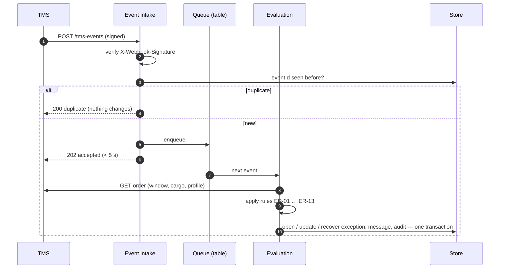

# Integration and API

> **What this is:** how the exception component talks to the TMS and to its users — the events, the REST contract, and what happens when things go wrong. **For:** developers, the TMS supplier, testers, application support. **Previous:** [architecture overview](README.md) · **Next:** [data model and state machines](data-model-and-states.md).

*Proposed design for a fictional organisation. TMS behaviour is an assumption (A-01, confirmed in the case's sprint-0 spike), not a statement about any real product.*

## TMS integration assumptions

| ID | Assumption | Consequence if wrong | How we would check |
|---|---|---|---|
| TA-1 | The TMS publishes webhooks for status, ETA, window and sailing changes per order | We would have to poll the API (slower, more load) | Supplier documentation + spike (A-01) |
| TA-2 | Every webhook carries a unique, stable event ID | No reliable deduplication → NFR-03 at risk | Spike: send the same change twice |
| TA-3 | Webhooks arrive within 2 minutes (95%) | K2 "time to inform" target not reachable | Timestamps in the spike |
| TA-4 | Webhooks can arrive **out of order** and **more than once** | Wrong severity if an older ETA overwrites a newer one | Design for it anyway: compare `occurredAt` |
| TA-5 | The REST API returns window, cargo type and customer profile for an order | The rules lack inputs | Spike |
| TA-6 | Sailing changes arrive as one event per sailing, not per order | The component must fan out to all orders on the sailing | Supplier documentation |

## Event-driven integration — the flow

**Why a queue table and not a broker:** one source, ±1,600 orders a week, a few thousand events a day. A table with a status column, processed in `occurredAt` order per order, gives ordering, retries and visibility without new infrastructure for support to run. Re-assess if volume grows tenfold or a second event source joins.

## Idempotency, duplicates and ordering

| Situation | Handling | Requirement / test |
|---|---|---|
| Same event ID twice | Second one returns `200`, changes nothing, logged as `EVENT_DUPLICATE` | NFR-03 · demo unit test "idempotency" · contract test "duplicate event returns 200" |
| Same command retried (network timeout on the planner's side) | `Idempotency-Key` header; the second call returns the first result | contract test "retried command … applied once" |
| Older event arrives after a newer one for the same order | Ignore absolute ETA changes whose `occurredAt` is older than the last applied change for that order; still audit them (`STALE_IGNORED`, HTTP 200) | **implemented in the demo** — guided scenario step 3, TC-34. Sailing delays are deltas and are not reordered; a corrected sailing time arrives as a new event |
| Sailing event affects many orders | Fan out; evaluate each order; one audit line for the event plus one per order | demo step 3: 11 orders, 4 exceptions |
| Two causes on one order (sailing delay, then road re-plan) | Throttle **per order** (ER-12 after DEF-04) | AC-07.x; demo keeps one active exception per order |

## Retries and failure handling

| Failure | Proposed behaviour | Who notices |
|---|---|---|
| TMS API call fails while evaluating | Retry 3× with back-off (2 s, 10 s, 60 s); then mark the event **failed**, alert application support; nothing half-applied | Application support alert |
| No webhook for 15 min during planning hours | Heartbeat alert; re-read orders changed since the last event via the API (NFR-04) | Application support |
| Notification service unavailable | Message stays **pending** and is retried; the exception shows "message not yet sent" | Planner sees it on the exception |
| E-mail bounces | Exception flagged "message failed"; call task for CS (FR-09) | CS |
| Rule module throws on unexpected input | Event marked failed with the input logged; no customer message; alert | Application support |
| TMS read fails for a workbench user | `503` problem details; workbench shows last known data and "try again" | Planner (demo: "Simulate TMS outage") |

## REST contract

The full contract is [`demo/mock-apis/openapi.yaml`](../../demo/mock-apis/openapi.yaml) (OpenAPI 3.1, linted with Redocly in CI). The demo's mock API implements it; a [contract test](../../demo/application/tests/unit/contract.test.ts) checks every response type and every example against the schemas.

| Endpoint | Used by | Purpose | Story |
|---|---|---|---|
| `POST /tms-events` | TMS (webhook) | One change; `202` new, `200` duplicate | EN-1, US-01 |
| `GET /shipments`, `GET /shipments/{orderRef}` | Workbench | Read-through of order data for context | US-03 |
| `GET /exceptions`, `GET /exceptions/{id}` | Workbench | Work list, most urgent first; detail with evaluations | US-03 |
| `POST /exceptions/{id}/acknowledge` | Planner | OPEN → ACKNOWLEDGED | US-04 |
| `POST /exceptions/{id}/assign` | Shift lead | Assign to a planner of the owner group | US-03 (AC-03.5) |
| `POST /exceptions/{id}/actions` | Owner | Register a response action | US-04 |
| `POST /exceptions/{id}/confirm-status` | Planner | Held missing status → on time (closed) or delayed (re-evaluated) | US-08 |
| `POST /exceptions/{id}/replan` | Planner | New agreed window; re-evaluate (ER-13) | US-04, US-10 |
| `POST /exceptions/{id}/resolve` | Owner | Resolve with mandatory reason | US-04 |
| `POST /messages/{id}/send` | Planner | Add a note to a pending critical message and send now | US-05 (AC-05.4) |
| `POST /call-tasks/{id}/complete` | CS agent | Close the call task with an outcome | US-11 |
| `GET /orders/{orderRef}/tracking` | Customer portal | What the customer was told — nothing internal | US-05, US-10 |
| `GET /pilot-export?date=` | PO, Head of CS | Daily CSV for the stage gate | US-13 |

### Example payloads

Generated from the engine (so they cannot drift from the behaviour) — [`demo/mock-apis/examples/`](../../demo/mock-apis/examples/):

- [`tms-event-sailing-delayed.json`](../../demo/mock-apis/examples/tms-event-sailing-delayed.json) — the scenario's inbound event
- [`event-outcome-processed.json`](../../demo/mock-apis/examples/event-outcome-processed.json) — 11 orders evaluated, 4 exceptions opened
- [`exception-critical.json`](../../demo/mock-apis/examples/exception-critical.json) — the critical exception with its evaluation and rule IDs
- [`tracking-delayed.json`](../../demo/mock-apis/examples/tracking-delayed.json) — what the customer receives
- [`problem-409.json`](../../demo/mock-apis/examples/problem-409.json) — resolving an exception nobody acknowledged

### Error model

RFC 9457 problem details (`application/problem+json`): `type`, `title`, `status`, `detail`.

| Status | When | Example detail |
|---|---|---|
| 401 | Missing or invalid token / webhook signature | — |
| 403 | Role may not do this (NFR-06) | "Customer service agent cannot change exceptions owned by Road planning" |
| 404 | Unknown order, exception, message or task | "Order D2D-99999 does not exist" |
| 409 | Not possible in the current state | "Acknowledge the exception before resolving it (now OPEN)" |
| 422 | Invalid input | "A note is required when the reason is "other" (AC-04.3)" |
| 503 | TMS unavailable for a read | "The TMS API did not answer…" |

## How a BA uses this page with the team

- In **refinement**, walk the failure table: every row is either an acceptance criterion, a support alert or a conscious "not now".
- With the **supplier**, the assumptions table is the agenda of the spike — each TA becomes "confirmed", "wrong, here is the impact" or "unknown, here is the risk".
- With **testers**, the idempotency and ordering table is a ready list of negative tests ([test cases](../09-acceptance/test-cases.md)).

---

[Documentation map](../00-documentation-map.md) · Next: [Data model and state machines →](data-model-and-states.md)
